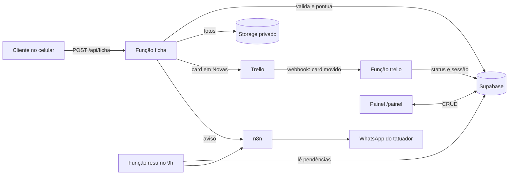

# Russo · Pré-atendimento para tatuadores

O cliente preenche uma ficha pelo celular: ideia, local do corpo, tamanho, faixa de investimento e fotos. A ficha é validada e gravada no Supabase, ganha uma nota (quente, morna ou fria) e vira um card na coluna **Novas** do quadro do tatuador no Trello. A ficha quente chega na hora no WhatsApp dele.

Daí em diante o **quadro manda**: mover o card muda o status da ficha no banco, e mover para **Agendado** com a data preenchida cria a sessão na agenda. Todo dia às 9h sai um resumo do que está esperando resposta.

O tatuador também tem um **painel** em `/painel`, feito com Bootstrap 5, com login e CRUD completo das fichas.

O cliente real é o tatuador Vinicius Russo ([@russo.tattooer](https://instagram.com/russo.tattooer)). Este repositório é o trabalho de Desenvolvimento Web do IFES construído em cima da ficha dele. Persona: o tatuador que não quer ser atendente.

## Integrantes

| Integrante | Frente |
| --- | --- |
| Caio Sperandio | Análise e negócio: viabilidade, preço e documento em PDF |
| Elson Ramos | Banco no Supabase: tabelas, regras de acesso e dados de exemplo |
| Álvaro de Vargas | Quadro no Trello: card, colunas e sincronização de status |
| Arthur de França | Sessões e resumo diário |
| Matheus de Oliveira Fragoso | Ficha pública, interface e testes no celular |
| Nikolas Robert | Arquitetura, funções do Netlify, painel, n8n, WhatsApp e deploy |

## Situação

| Sprint | Data | Situação |
| --- | --- | --- |
| 1 · Análise e planejamento | 22/10 | Entregue: [docs/analise/sprint-1.md](docs/analise/sprint-1.md) |
| 2 · Negócio e base técnica | 27/10 | Entregue: [docs/analise/sprint-2.md](docs/analise/sprint-2.md) |
| 3 · Funcionalidades | 05/11 e 11/11 | Entregue: painel com CRUD, validação, Bootstrap, CSRF e `esc()` |
| 4 · Entrega final | 24/11 e 26/11 | Ficha gravando no Supabase, Trello sincronizado, sessões e resumo: [docs/entrega-final.md](docs/entrega-final.md) |

Backlog por integrante: [docs/backlog.md](docs/backlog.md) · Roteiro das apresentações: [docs/cronograma.md](docs/cronograma.md) · Como colocar no ar: [docs/deploy.md](docs/deploy.md)

## Tecnologias

| Parte | Tecnologia |
| --- | --- |
| Ficha pública (View) | HTML, CSS e JavaScript puros, mobile-first |
| Painel do tatuador (View) | HTML gerado no servidor com Bootstrap 5.3 |
| API (Controller) | Netlify Functions em Node.js 20, sem dependências externas |
| Banco e fotos (Model) | Supabase: Postgres, Storage privado e regras de acesso por linha (RLS) |
| Quadro de atendimento | Trello (API REST e webhook) |
| Aviso | n8n + WhatsApp Cloud API |

## Como funciona



## Como rodar

Requisitos: Node.js 20 ou mais novo e o [Netlify CLI](https://docs.netlify.com/cli/get-started/). Não há `npm install`: o projeto não usa pacotes de fora.

```bash
git clone https://github.com/nikolasrobert/russo-pre-atendimento.git
cd russo-pre-atendimento
npm test            # ficha, Trello, sessões, resumo, n8n e painel
netlify dev         # ficha em http://localhost:8888 e painel em /painel
```

Para ver o painel sem configurar nada: `PAINEL_DEMO=1 netlify dev` e abra http://localhost:8888/painel (login `demo@painel.local` / `demo1234`).

As variáveis de ambiente estão em [.env.example](.env.example) e explicadas em [docs/deploy.md](docs/deploy.md). Nenhuma chave vai para o Git.

## Estrutura (MVC)

```
site/                    View da ficha do cliente; site/assets/ tem o CSS e o JS do painel
netlify/functions/       Pontos de entrada: ficha, arquivo, trello, resumo e painel
netlify/lib/ficha/       Controller da ficha: tradução das respostas, validação e gravação
netlify/lib/painel/      Painel em MVC: app.mjs (controller), models/, views/, stores/, validacao.mjs, seguranca.mjs
netlify/lib/             Clientes do Supabase e do Trello, quadro (status e sessões), resumo e avisos
supabase/                Model: tabelas, regras de acesso e dados de exemplo
n8n/                     Fluxo que recebe os avisos e manda no WhatsApp
whatsapp/                Modelos de mensagem para aprovar na Meta
scripts/                 Criar o quadro e o webhook no Trello, gerar hash de senha
docs/                    Análise, modelo de dados, backlog, cronograma, deploy e entrega final
referencia/              Regras de pontuação e o fluxo antigo com o Notion
tests/                   Testes automatizados (node --test)
```

## Rotas

| Método | Rota | O que faz |
| --- | --- | --- |
| GET | `/` | Abre a ficha |
| POST | `/api/ficha` | Valida, pontua, grava no Supabase, sobe as fotos, cria o card e pede o aviso |
| GET | `/arquivo/:ficha/:foto` | Redireciona para um link assinado de 5 minutos da foto |
| HEAD, POST | `/api/trello` | Webhook do Trello: card movido atualiza o status; "Agendado" com data cria a sessão |
| CRON | todo dia às 9h (12h UTC) | Função `resumo`: pendências do dia para o WhatsApp |
| POST | `/webhook/russo-avisos` (no n8n) | Recebe o aviso e manda no WhatsApp |

### Rotas do painel (todas pedem login; todo POST pede o token CSRF)

| Método | Rota | O que faz |
| --- | --- | --- |
| GET, POST | `/painel/entrar` | Login |
| POST | `/painel/sair` | Encerra a sessão |
| GET | `/painel` | Lista as fichas, com busca e filtros por status, temperatura e região |
| GET | `/painel/fichas/nova` | Formulário de nova ficha |
| POST | `/painel/fichas` | Cria a ficha (Create) |
| GET | `/painel/fichas/:id` | Mostra a ficha, a sessão marcada e o link do card (Read) |
| GET | `/painel/fichas/:id/editar` | Formulário de edição |
| POST | `/painel/fichas/:id` | Salva a edição (Update) |
| GET, POST | `/painel/fichas/:id/excluir` | Confirma e exclui (Delete) |

## Segurança

- **Validação no servidor** com mensagens em português, a mesma regra para a ficha pública e para o painel (`netlify/lib/painel/validacao.mjs`). O banco repete as regras principais como última barreira.
- **CSRF** no painel: token num cookie `HttpOnly` + `SameSite=Strict` e no formulário. POST sem o token certo recebe 403.
- **`esc()`** em todo valor do banco ou do usuário antes de ir para o HTML.
- **Senha** só como hash scrypt; sessão em cookie assinado com HMAC, `HttpOnly`, `Secure`, 8 horas.
- **Webhook do Trello** só é aceito com a assinatura HMAC do Trello conferida.
- **Fotos** num bucket privado; só abrem por link assinado de 5 minutos.
- **RLS**: cada estúdio só enxerga os próprios dados. Testado no banco real com um segundo estúdio.
- **Chaves** só em variáveis de ambiente; a chave do Supabase e o token do Trello vão no cabeçalho, nunca na URL nem no navegador.

## Como contribuir

1. Crie uma branch por tarefa: `git checkout -b docs/testes-celular`.
2. Commits pequenos, em português: `docs(teste): ficha testada em 3 celulares`.
3. Abra um pull request e peça revisão de outra pessoa do grupo.

A tarefa de cada um para a entrega final está em [docs/tarefas-integrantes.md](docs/tarefas-integrantes.md).
