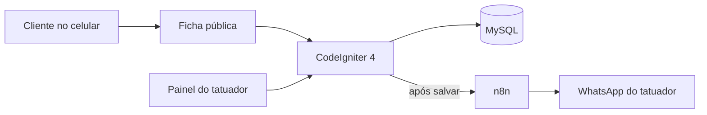

# Sprint 1 · Análise e planejamento

Apresentação: 22/10/2026. Este documento é a base do PDF de análise entregue no fim do trabalho.

## 1. Problema

O tatuador perde orçamento na DM do Instagram. A bio do cliente real diz "orçamentos via DM" e não tem link. Os pedidos chegam soltos, sem foto do local, sem tamanho e sem referência, e cada orçamento vira uma conversa de idas e vindas.

Com a agenda lotada, ele demora a responder. Curiosos e clientes prontos para fechar ficam na mesma fila, e quem quer atenção esfria ou procura outro estúdio.

## 2. Pesquisa

Duas frentes, em outubro de 2026:

**Perfil @russo.tattooer no Instagram (comentários públicos)**

- Os comentários são quase todos elogios.
- Frases como "eu quero" e "te mandei direct, aceita lá" são clientes em potencial sem nenhum acompanhamento.
- As dúvidas de verdade (preço, agenda, tamanho) vão para a DM.

**Conversa com o tatuador**

- Agenda sempre lotada.
- Muita dificuldade de responder mensagens; perde clientes e gera atrito com quem quer atenção.
- É desconfiado de atendimento automatizado. Requisito que sai daqui: os textos precisam soar como ele.
- Trabalha muito no freehand, quase tudo em preto e cinza; mãos e dedos são especialidade.

## 3. Persona

**Vinicius "Russo"**, 25 anos, tatuador autônomo no Expurgo Tattoo, Vila Velha (ES). Atende Vitória e Vila Velha.

| | |
| --- | --- |
| Contexto | Tatua freehand, em preto e cinza: dark ornamental, blackwork, anime, lettering. Vende pelo Instagram e fecha pelo WhatsApp. |
| Objetivos | Passar o dia tatuando, não respondendo mensagem. Chegar na conversa sabendo ideia, local, tamanho e quanto o cliente quer investir. |
| Dores | Perde orçamento na DM, responde tarde, repete as mesmas perguntas e não sabe quem está pronto para fechar. |
| Comportamento digital | Usa o celular o dia todo, Instagram e WhatsApp. Não usa sistema de gestão. Fala direto e informal ("mano", "brabo", "tamo junto"). |

Fundamentação: entrevista com o tatuador e observação do perfil público. É um cliente real, não uma persona inventada.

**Usuário secundário:** o cliente final, que chega pelo Instagram no celular e preenche a ficha.

## 4. Público-alvo

| Segmentação | Descrição |
| --- | --- |
| Demográfica | Tatuadores autônomos (MEI) e estúdios pequenos, de 1 a 3 artistas |
| Geográfica | Começo na Grande Vitória (ES); depois, qualquer cidade |
| Comportamental | Capta pelo Instagram, fecha pelo WhatsApp, não usa sistema de gestão |

**Tamanho do mercado.** Segundo levantamento do Sebrae com dados do CNAE, 6.763 negócios de tatuagem e piercing foram abertos no Brasil em 2022, 97% deles como MEI. As aberturas cresceram 35% de 2019 a 2022 ([Money Times, abr/2023](https://www.moneytimes.com.br/microempreendedores-individuais-representam-97-dos-estudios-de-tatuagem-e-piercing-abertos-em-2022/)). O número do Espírito Santo será levantado na Sprint 2.

**Por que esse público precisa da solução:** quase todo tatuador trabalha sozinho e cuida ao mesmo tempo de atendimento, arte e agenda. O atendimento é o que fica para depois.

## 5. Proposta de valor

O tatuador chega na conversa sabendo o que o cliente quer, onde, de que tamanho e quanto quer investir.

- Uma ficha no link da bio, na voz do tatuador.
- Um painel que mostra primeiro quem está pronto para fechar.
- Um aviso na hora no WhatsApp.

## 6. Requisitos funcionais

| Código | Requisito | Quem usa | MoSCoW |
| --- | --- | --- | --- |
| RF01 | Enviar ficha com ideia, local, tamanho, faixa de investimento e contato | Cliente | Must |
| RF02 | Enviar fotos do local do corpo e de referência | Cliente | Must |
| RF03 | Pontuar cada ficha como quente, morna ou fria | Sistema | Should |
| RF04 | Entrar no painel com e-mail e senha | Tatuador | Must |
| RF05 | Listar fichas e filtrar por status e região | Tatuador | Must |
| RF06 | Ver, editar status e orçamento, e excluir uma ficha | Tatuador | Must |
| RF07 | Cadastrar, editar e excluir clientes | Tatuador | Must |
| RF08 | Agendar sessões de uma ficha fechada | Tatuador | Should |
| RF09 | Avisar o tatuador no WhatsApp quando chega ficha | Sistema | Should |
| RF10 | Resumo diário das fichas pendentes no WhatsApp | Sistema | Could |

## 7. Requisitos não funcionais

| Código | Requisito |
| --- | --- |
| RNF01 | A ficha pública funciona bem na tela do celular (mobile-first) |
| RNF02 | CSRF ativo, `esc()` em toda saída, senha com hash e credenciais só no `.env` |
| RNF03 | LGPD: a ficha não pede dados de saúde; fotos só abrem com login |
| RNF04 | Fotos comprimidas no celular antes do envio (até 1600 px) |
| RNF05 | Textos e mensagens de erro em português, na voz do tatuador |
| RNF06 | PHP 8.2+, MySQL, padrão MVC do CodeIgniter 4, migrations e seeders |

## 8. Histórias de usuário

| História | Requisitos |
| --- | --- |
| Como cliente, quero mandar minha ideia com fotos pelo celular, para receber um orçamento sem ficar trocando mensagem. | RF01, RF02 |
| Como tatuador, quero ver primeiro as fichas quentes, para responder antes quem está pronto para fechar. | RF03, RF05 |
| Como tatuador, quero mudar o status e o valor de cada orçamento, para saber em que pé está cada cliente. | RF04, RF06, RF07 |
| Como tatuador, quero marcar as sessões de quem fechou, para não perder o controle da agenda. | RF08 |
| Como tatuador, quero receber um aviso no WhatsApp quando chega ficha, para não depender de abrir o painel. | RF09 |

## 9. Matriz MoSCoW

| Must | Should | Could | Won't (agora) |
| --- | --- | --- | --- |
| Ficha com fotos | Pontuação quente, morna, fria | Resumo diário no WhatsApp | Pagamento online do sinal |
| Login do painel | Agenda de sessões | Exportar fichas | Agenda pública |
| Lista com filtros | Aviso no WhatsApp | | App nativo |
| CRUD de fichas | | | |
| CRUD de clientes | | | |

**Como a matriz decide o plano:** os itens Must entram na Sprint 3, parte 1 (05/11). Os Should entram na parte 2 (11/11). Os Could só entram se sobrar tempo. Os Won't ficam fora do trabalho por custo ou complexidade.

## 10. Arquitetura

## 11. Próxima sprint (27/10)

- Viabilidade: concorrentes, diferencial, modelo de assinatura e riscos.
- Estimativa de preço: horas, hospedagem, domínio, custo do WhatsApp, manutenção e margem.
- Base técnica: CodeIgniter 4 rodando, banco criado por migrations e seeders, README.
