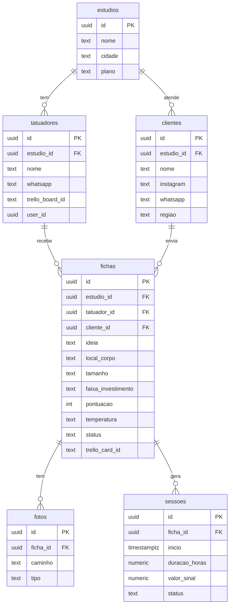

# Modelo de dados

Banco no Supabase (Postgres). O esquema está em [supabase/migrations/0001_schema.sql](../supabase/migrations/0001_schema.sql) e [0002_sprint4.sql](../supabase/migrations/0002_sprint4.sql), e os dados de exemplo em [supabase/seed.sql](../supabase/seed.sql). Estão aplicados no projeto `russo-pre-atendimento` do Supabase.

A Sprint 4 acrescentou em `fichas`: `trello_card_url` (link do card), `extras` (respostas sem coluna própria, como a idade da tattoo coberta) e `canal` (`site` ou `painel`); e em `sessoes` uma regra que permite só uma sessão marcada por ficha.

O banco foi pensado para vários clientes: tudo pendura num estúdio, e cada estúdio só enxerga os próprios dados pela regra de segurança por linha (RLS). As funções do Netlify e o n8n usam a chave de serviço, que fica só no servidor.

## Tabelas

| Tabela | Para quê | Regras principais |
| --- | --- | --- |
| `estudios` | Cada cliente nosso: um tatuador sozinho ou um estúdio | `plano` = `tatuador` ou `estudio` |
| `tatuadores` | Quem recebe as fichas | WhatsApp com 12 ou 13 dígitos; `user_id` liga ao login do Supabase |
| `clientes` | Quem preenche a ficha | Instagram válido e único por estúdio; `regiao` = `grande_vitoria` ou `fora` |
| `fichas` | Cada pedido de orçamento | Ideia com 10+ caracteres; data obrigatória com "Tenho data marcada"; quem indicou obrigatório com "Indicação"; `status` numa lista fechada |
| `fotos` | Fotos do local, referências e tattoo a cobrir | Caminho no bucket privado `fichas`; apagadas junto com a ficha |
| `sessoes` | Sessões marcadas de uma ficha fechada | Duração de 0,5 a 12 horas |

Status da ficha, na ordem do quadro: `novo` → `em_conversa` → `orcamento_enviado` → `agendado` → `fechado`, ou `perdido`. Arquivar o card no Trello marca `arquivado` (exclusão lógica).

Temperatura: 8 pontos ou mais é `quente`, de 4 a 7 é `morna`, até 3 é `fria`. Regras em [referencia/pontuacao.md](../referencia/pontuacao.md).

## Como o CRUD acontece

| Operação | Onde |
| --- | --- |
| Criar | O cliente envia a ficha (`POST /api/ficha`) |
| Ler | O tatuador vê o card no Trello; o n8n lê o banco para o resumo diário |
| Atualizar | Mover o card muda o `status`; editar o card muda `valor_orcamento` |
| Excluir | Arquivar o card marca a ficha como `arquivado` |
