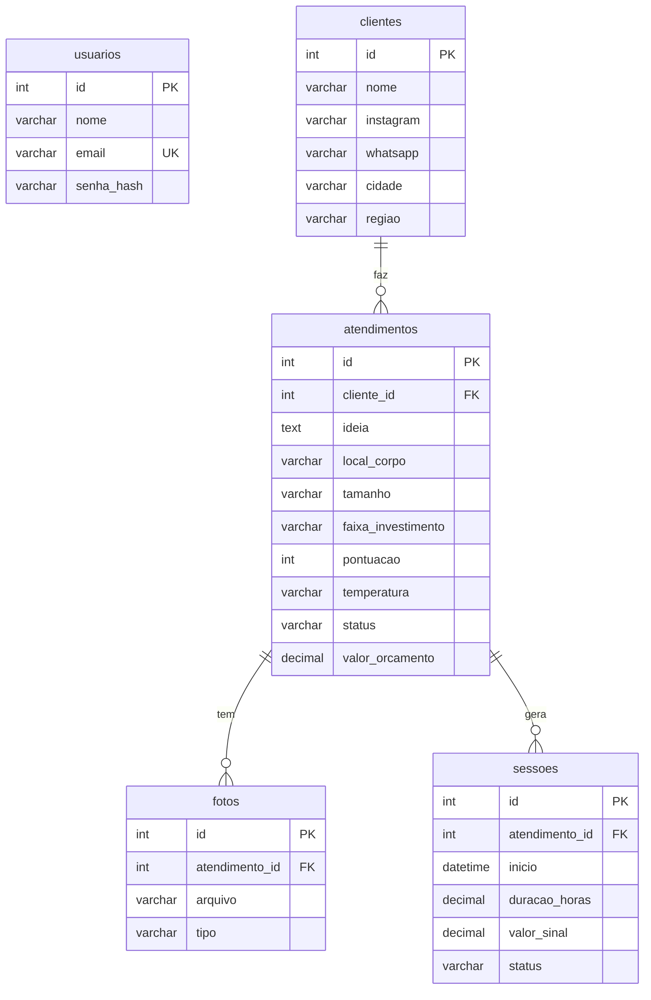

# Modelo de dados

Banco `russo_painel` (MySQL, `utf8mb4`). Cada tabela vira uma migration em `app/Database/Migrations` e um Model em `app/Models`. Os valores das listas vêm das perguntas da ficha que já está no ar ([referencia/ficha-original.html](../referencia/ficha-original.html)).

## usuarios

Quem entra no painel (o tatuador).

| Campo | Tipo | Regra |
| --- | --- | --- |
| id | INT, PK, auto incremento | |
| nome | VARCHAR(100) | obrigatório |
| email | VARCHAR(150) | obrigatório, único, e-mail válido |
| senha_hash | VARCHAR(255) | `password_hash()`, nunca a senha pura |
| created_at, updated_at | DATETIME | `useTimestamps` |

## clientes

| Campo | Tipo | Regra |
| --- | --- | --- |
| id | INT, PK | |
| nome | VARCHAR(100) | obrigatório, 2 a 100 caracteres |
| instagram | VARCHAR(60) | obrigatório, sem o `@` |
| whatsapp | VARCHAR(20) | obrigatório, só dígitos, 10 a 13 |
| cidade | VARCHAR(80) | obrigatório |
| regiao | VARCHAR(20) | `grande_vitoria` ou `fora` |
| created_at, updated_at | DATETIME | |

Cidades da Grande Vitória na ficha: Vitória, Vila Velha, Serra, Cariacica, Viana, Guarapari, Fundão. Qualquer outra vira `fora`.

## atendimentos

Uma ficha enviada. Um cliente pode ter várias.

| Campo | Tipo | Regra |
| --- | --- | --- |
| id | INT, PK | |
| cliente_id | INT, FK → clientes.id | obrigatório |
| experiencia | VARCHAR(30) | É a primeira · Tenho uma ou duas · Sou bem tatuado(a) · Você já me tatuou |
| ideia | TEXT | obrigatório, mínimo 10 caracteres |
| link_referencia | VARCHAR(255) | opcional, URL válida |
| local_corpo | VARCHAR(40) | obrigatório, da lista da ficha |
| tamanho | VARCHAR(40) | Até 5 cm · 5 a 10 cm · 10 a 15 cm · 15 a 25 cm · Mais de 25 cm · Fechamento · Não sei |
| cobertura | TINYINT(1) | 0 ou 1 |
| cor | VARCHAR(20) | Preto e cinza · Colorido · Confio em você |
| faixa_investimento | VARCHAR(30) | Até R$ 500 · R$ 500 a 1.000 · R$ 1.000 a 2.000 · R$ 2.000 a 4.000 · Acima de R$ 4.000 · Prefiro que você me diga |
| prazo | VARCHAR(40) | Sem pressa · Nos próximos 30 dias · Tenho data marcada |
| data_limite | DATE | obrigatório só quando prazo = Tenho data marcada |
| disponibilidade | VARCHAR(120) | uma ou mais opções, separadas por vírgula |
| origem | VARCHAR(30) | Instagram · Indicação · Convenção / evento · Passei no estúdio · Outro |
| indicado_por | VARCHAR(80) | obrigatório só quando origem = Indicação |
| pontuacao | INT | calculada (ver [referencia/pontuacao.md](../referencia/pontuacao.md)) |
| temperatura | VARCHAR(10) | `quente` · `morna` · `fria` |
| status | VARCHAR(20) | `novo` · `em_conversa` · `orcamento_enviado` · `agendado` · `fechado` · `perdido`; padrão `novo` |
| valor_orcamento | DECIMAL(10,2) | opcional, maior que zero |
| observacoes | TEXT | opcional, anotação do tatuador |
| created_at, updated_at | DATETIME | |

## fotos

| Campo | Tipo | Regra |
| --- | --- | --- |
| id | INT, PK | |
| atendimento_id | INT, FK → atendimentos.id, `ON DELETE CASCADE` | |
| arquivo | VARCHAR(255) | caminho dentro de `writable/uploads/fichas/{atendimento_id}/` |
| tipo | VARCHAR(20) | `local` · `referencia` · `cobertura` |
| created_at | DATETIME | |

As fotos ficam em `writable/`, fora da pasta pública, e só abrem por uma rota do painel com login (LGPD).

## sessoes

| Campo | Tipo | Regra |
| --- | --- | --- |
| id | INT, PK | |
| atendimento_id | INT, FK → atendimentos.id | obrigatório |
| inicio | DATETIME | obrigatório, data futura ao criar |
| duracao_horas | DECIMAL(4,1) | obrigatório, de 0,5 a 12 |
| valor_sinal | DECIMAL(10,2) | opcional |
| status | VARCHAR(20) | `marcada` · `realizada` · `remarcada` · `cancelada` |
| created_at, updated_at | DATETIME | |

## Seeders

- `UsuarioSeeder`: o login do tatuador, senha lida de `PAINEL_SENHA_INICIAL` no `.env`.
- `ExemploSeeder`: cerca de 8 clientes e fichas fictícias, a maioria da Grande Vitória.
- `DatabaseSeeder`: chama os dois.
